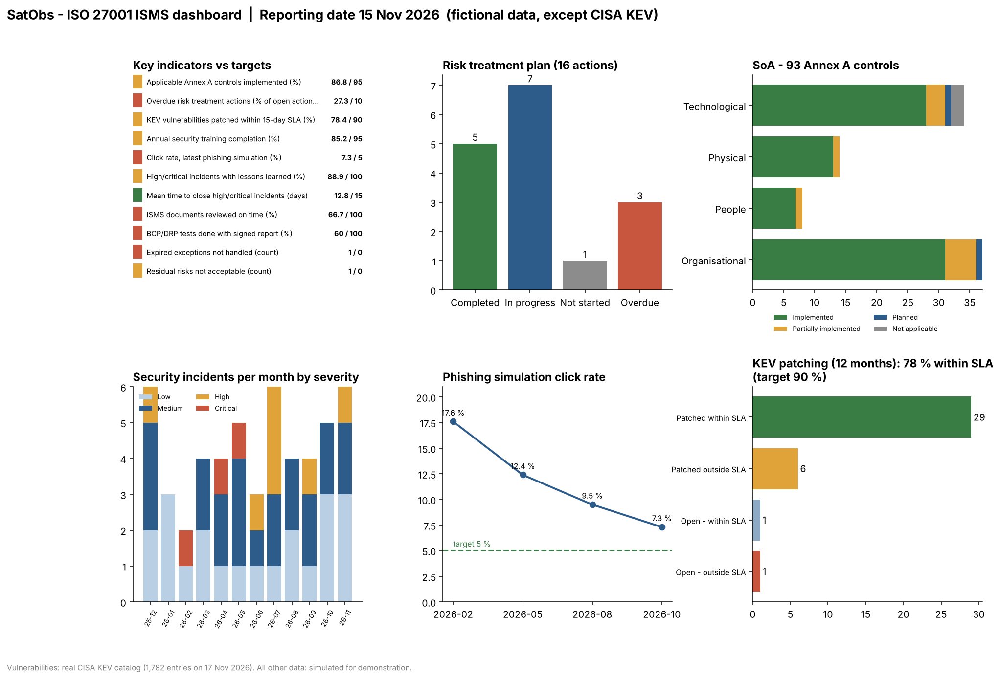

# ISO/IEC 27001:2022 ISMS Operations: SatObs (Earth-Observation Data Platform)

This portfolio project simulates **one reporting cycle of a certified Information Security Management System (ISMS)**. The company is **SatObs**, a fictional Earth-observation company in Sophia Antipolis, France. It receives, processes, archives and distributes satellite imagery for environmental monitoring.

The project does **not** build an ISMS from scratch. It reproduces the **day-to-day work of an ISMS / Security Quality Engineer**:

- maintaining indicators and evidence;
- following up action plans;
- running risk reviews;
- updating the Statement of Applicability (SoA);
- managing exceptions;
- performing an internal audit;
- preparing the security committee and the management review;
- maintaining BIA / BCP / DRP records;
- regulatory watch;
- awareness campaigns.

---

## Data

| Data | Type |
|---|---|
| **CISA Known Exploited Vulnerabilities (KEV) catalog** (1,782 entries, downloaded 17 Nov 2026) | ✅ **Real public data** (<https://www.cisa.gov/known-exploited-vulnerabilities-catalog>) |
| ISO/IEC 27001:2022 Annex A control list (93 controls, titles only) | Public reference |
| ANSSI EBIOS Risk Manager approach (simplified) | Public method |
| SatObs assets, risks, incidents, campaigns, tests, patch dates | ⚠️ **Fictional / synthetic** (generated with a fixed random seed for reproducibility) |

---

## What was done, mapped to the ISMS role

| Typical ISMS engineer task | Deliverable in this repo |
|---|---|
| Context and scope (ISO 27001 §4) | `01_context/satobs_context_and_isms_scope.md`, including the **climate-change amendment (Amd 1:2024)** |
| Asset inventory | `02_assets_and_risks/asset_inventory.csv` (17 assets, owners, C/I/A ratings) |
| Apply the risk method and run risk reviews with owners | `02_assets_and_risks/risk_register.csv` (16 scenarios, gross and residual) + `risk_method_and_risk_review_2026-11.md` + heat map |
| Follow risk treatment plans and collect evidence | `02_assets_and_risks/risk_treatment_plan.csv` (16 actions, overdue actions flagged) |
| Update the Statement of Applicability | `03_statement_of_applicability/statement_of_applicability.csv` (all **93 controls**) + update note |
| Record and follow exceptions | `03_statement_of_applicability/exception_register.csv` (expiry alerts) |
| Technical vulnerability management (A.8.8) using real data | `04_vulnerability_management/` (KEV vs company tech stack, 15-day SLA KPI) |
| Internal audit, findings and corrective actions | `05_internal_audit/internal_audit_report_IA-2026-03.md` (checklist, 2 minor NCs, 1 observation, root causes) + `corrective_actions.csv` |
| Maintain ISMS indicators (§9.1) | `06_dashboard/` (11 KPIs with targets and RAG status, dashboard, risk heat map) |
| Organise the Information Security Committee | `07_committee_and_management_review/information_security_committee_2026-11.md` (agenda, minutes, action log) |
| Prepare the management review (§9.3) | `07_committee_and_management_review/management_review_inputs_2027.md` |
| BIA, BCP/DRP, continuity test schedule | `08_business_continuity/` (6 processes with RTO/RPO, 8 tests, results consolidated) |
| Regulatory watch and applicability analysis | `09_regulatory_watch/regulatory_watch_2026-11.md` (NIS 2 / French "loi Résilience", Amd 1:2024, CRA, GDPR, EU Space Act) |
| Awareness material and campaigns | `10_awareness/` (2027 plan, participation and phishing KPIs, one-page phishing guide) |
| Document control (§7.5) | `11_document_control/document_register.csv` (overdue reviews flagged) |
| Everything in one workbook | `ISMS_SatObs_registers.xlsx` (14 sheets) |

## Key findings of this cycle (simulated)

- **78.4 %** of exploited vulnerabilities (KEV) affecting the stack were patched within the 15-day SLA (target 90 %). The VPN appliance is the most exposed asset: 12 of its 15 KEV entries are linked to ransomware campaigns.
- **86.8 %** of applicable Annex A controls are fully implemented (target 95 %).
- **1 residual risk** is still not acceptable (R02, VPN), so it was escalated to the committee.
- The internal audit found **2 minor non-conformities**: patching outside the SLA with an expired exception, and an untested customer-portal DRP.
- The phishing click rate fell from **17.6 % to 7.3 %** over four simulations.

## Limits

- The company and all its operational data are fictional. The project shows **method and deliverables**, not a real certification.
- The ISO/IEC 27001 standard text is copyrighted, so only control numbers and titles are used.
- In a real ISMS, the risk method, thresholds and SLA would be those defined by the company.

---
Author: Waqas Saleem, Environmental & Energy Engineer moving into management systems (ISO 14001 / ISO 27001).
